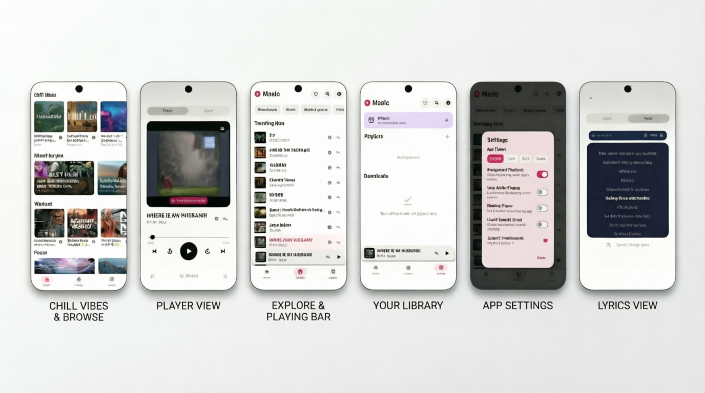

<div align="center">

# 🎧 Vyllo

### Your music. Your flow.

An unofficial Android music player for discovering and playing music from YouTube and YouTube Music—with background playback, an editable queue, offline downloads, lyrics, and a library that remembers what you love.

[](https://github.com/Flames14/Vyllo/actions/workflows/android-ci.yml)
[](https://www.android.com/)
[](LICENSE)



[Get Vyllo](https://github.com/Flames14/Vyllo/releases) · [Build it yourself](#build-from-source) · [Report an issue](https://github.com/Flames14/Vyllo/issues)

</div>

---

## Made for listening

Vyllo started with a simple idea: music should feel good to browse, easy to control, and ready to follow you between screens. Pick a track, shape your queue, save music for offline listening, or let the next song find its way to you.

### The good stuff

| 🎶 Listen | 📚 Make it yours | ✨ Set the mood |
|:--|:--|:--|
| Background audio and video playback | Playlists, likes, dislikes, and listening history | Synced lyrics and song recognition |
| Floating mini-player with transport controls | Reorder, remove, and clear upcoming tracks | Equalizer, volume boost, and sleep timer |
| Offline downloads | Backup and restore your library | Alarms and YouTube playlist sync |

Most features work without signing in. Google sign-in is optional for supported playlist-sync features.

## Get the app

Download the latest **published** APK from [GitHub Releases](https://github.com/Flames14/Vyllo/releases). Release builds are created by CI when a `v*` tag is pushed; pushing a regular branch does not publish an APK.

Install the downloaded `app-release.apk` and follow Android’s prompt if it asks permission to install from your browser or file manager. Vyllo supports Android 7.0 (API 24) and newer.

## Build from source

### You’ll need

- JDK 17
- Android SDK Platform 36 and its build tools
- Gradle 8.14.3 (the checked-in wrapper downloads and verifies it for you)

The project uses Kotlin 2.2.21, Android Gradle Plugin 8.13.2 and the Compose
compiler bundled with Kotlin.

### Build and verify

```bash
git clone https://github.com/Flames14/Vyllo.git
cd Vyllo
./gradlew :app:assembleDebug
```

On Windows, use `gradlew.bat` in place of `./gradlew`.

Run the project’s local checks:

```bash
./gradlew :app:testDebugUnitTest :app:lintDebug :app:assembleDebug :app:compileDebugAndroidTestKotlin
```

With an emulator or device connected, run the instrumented tests too:

```bash
./gradlew :app:connectedDebugAndroidTest
```

The debug APK appears at `app/build/outputs/apk/debug/app-debug.apk`.

### Production release build

Release builds are minified and resource-shrunk. They require Vyllo’s release signing credentials; Gradle checks the signer and APK alignment during packaging.

For a local build, copy `keystore.local.properties.example` to the git-ignored `keystore.local.properties` and add your authorized signing values. Or provide `VYLLO_STOREFILE`, `VYLLO_STOREPASSWORD`, `VYLLO_KEYALIAS`, and `VYLLO_KEYPASSWORD` as environment variables. **Never commit a keystore or passwords.**

```bash
./gradlew :app:assembleRelease
```

The APK is written to `app/build/outputs/apk/release/app-release.apk`. `-PallowDebugRelease` is for explicit local testing only; debug-signed builds are not suitable for distribution or production updates.

## Under the hood

Kotlin · Jetpack Compose · Material 3 · AndroidX Media3 · Room · DataStore · Hilt · NewPipe Extractor · OkHttp · Coil · WorkManager

## Want to help?

Found a bug or have an idea? [Open an issue](https://github.com/Flames14/Vyllo/issues). Pull requests are welcome—please run the checks above and, for bigger changes, start with an issue so we can talk through the approach.

## A quick note

Vyllo does not host or distribute music. Playback and availability depend on third-party services. Please respect applicable service terms and copyright. Vyllo is an independent project and is not affiliated with Google or YouTube.

## License

Vyllo is free software, licensed under the [GNU General Public License v3.0](LICENSE).
